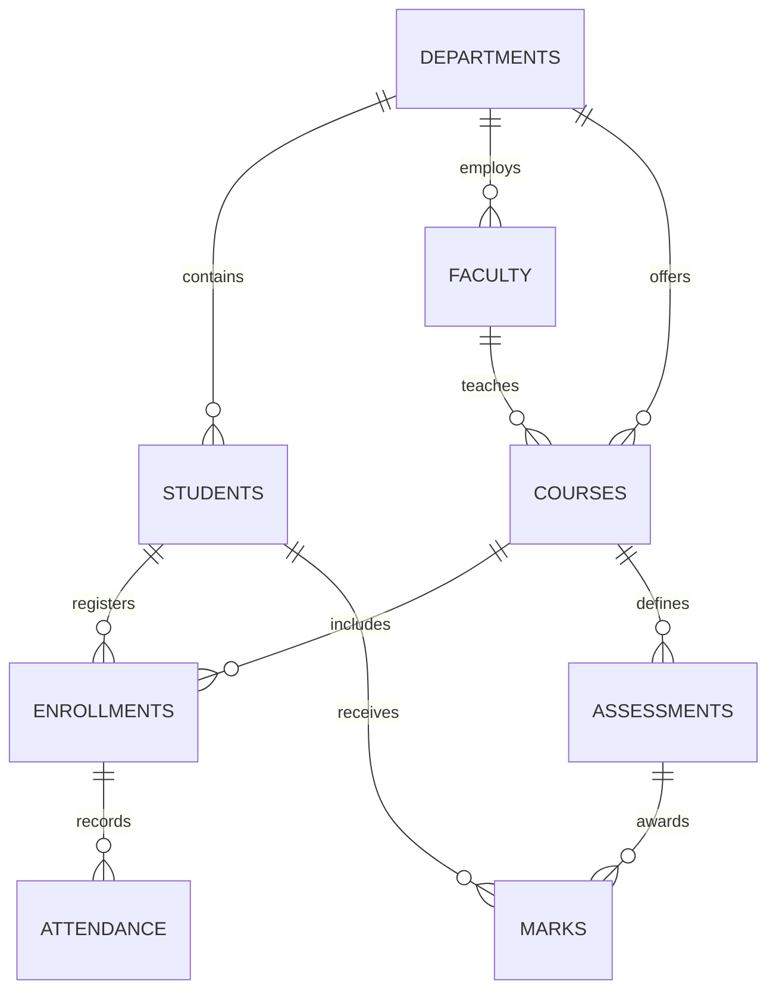

# Entity Relationship Diagram

The enrollment table resolves the many-to-many relationship between students and courses. Attendance belongs to a student's course enrollment, while marks connect a student to an assessment.
